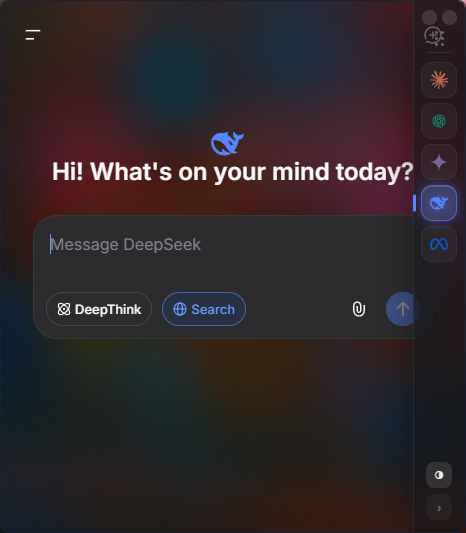

# Anion

> A small, always-handy glass window for every AI chat — built in Rust on `tao` + `wry`.

[](https://github.com/TF0X/anion/actions/workflows/ci.yml)
[](https://github.com/TF0X/anion/releases)




Anion is a tiny frameless window that parks in the corner of your screen and lets
you flip between **Claude, ChatGPT, Gemini, DeepSeek and Meta AI** from a glass
side-rail. The page frosts the desktop behind it, logins persist, and it weighs
about **0.6 MB** on disk because it uses the system WebView2 runtime instead of
bundling a browser.

> **Beta.** Windows 11 only, and rough edges remain (see [Known limitations](#known-limitations)).

## Features

- **One rail, every assistant** — a glass side-rail with the five providers; click
  to switch, and Anion remembers where you left off.
- **Glass** — a real `ACCENT_ENABLE_ACRYLICBLURBEHIND` backdrop with a light,
  tunable tint, plus an engine that makes the AI site's own chrome (headers, nav
  sidebars) translucent so the blur reads through. Cycle it with the ◐ button.
- **Persistent logins** — a dedicated WebView2 profile, so you stay signed in
  across restarts.
- **Memory-aware** — trims when idle and fully suspends (freezing, not discarding,
  so a half-typed message survives) when minimized.
- **Companion-sized** — opens small in the bottom-right, frameless, draggable,
  resizable, always a keystroke away.

## Install

Grab the latest `anion.exe` from the [Releases](https://github.com/TF0X/anion/releases)
page and run it. No installer, no admin. It needs the **WebView2 runtime**, which
ships with Windows 11 and current Windows 10.

Per-user install with a desktop shortcut:

```powershell
$dir = "$env:LOCALAPPDATA\Programs\Anion"
New-Item -ItemType Directory -Force $dir | Out-Null
Copy-Item .\anion.exe $dir
$s = (New-Object -ComObject WScript.Shell).CreateShortcut("$([Environment]::GetFolderPath('Desktop'))\Anion.lnk")
$s.TargetPath = "$dir\anion.exe"; $s.Save()
```

## Build from source

Requires the Rust toolchain (MSVC) and the Windows SDK / VS Build Tools.

```powershell
git clone https://github.com/TF0X/anion
cd anion
cargo build --release
# -> target/release/anion.exe
```

## Usage

- Click a provider in the side-rail to switch; the active one is highlighted.
- Drag the grip to move the window; grab any edge to resize.
- The **◐** button cycles page glass: Solid → Frosted → Clear.
- Set `PRISM_NOBLUR=1`-style behaviour is on by default; the blur is the
  `ACCENT_ENABLE_ACRYLICBLURBEHIND` accent, tinted light in `src/main.rs`.

## How it works

Anion is a single frameless `tao` window with one `wry` webview attached directly
to it — the arrangement where a transparent WebView2 composites with the DWM
acrylic backdrop. A script injected at document-start draws the side-rail in a
closed shadow root (so no site CSS can touch it), handles provider switching over
IPC, and makes the loaded site's opaque chrome translucent so the frost shows
through while text and content stay solid.

## CI / CD

GitHub Actions on `windows-latest`:

- **CI** (`.github/workflows/ci.yml`) — every push and PR: `cargo fmt --check`,
  `cargo clippy`, `cargo build --release`.
- **Release** (`.github/workflows/release.yml`) — any `v*` tag: builds and attaches
  `anion.exe` to the GitHub Release.

```bash
git tag v0.1.0-beta
git push origin v0.1.0-beta
```

## Known limitations

- **Windows 11 only.** The blur backdrop and transparency paths are Windows-specific.
- The acrylic-blur accent can smear slightly while *resizing* — inherent to that mode.
- Page glass is heuristic; a provider that restructures its DOM may leave a stray
  opaque strip.
- These are third-party web apps loaded in a webview; Anion is not affiliated with
  any of the AI providers.

## License

MIT
